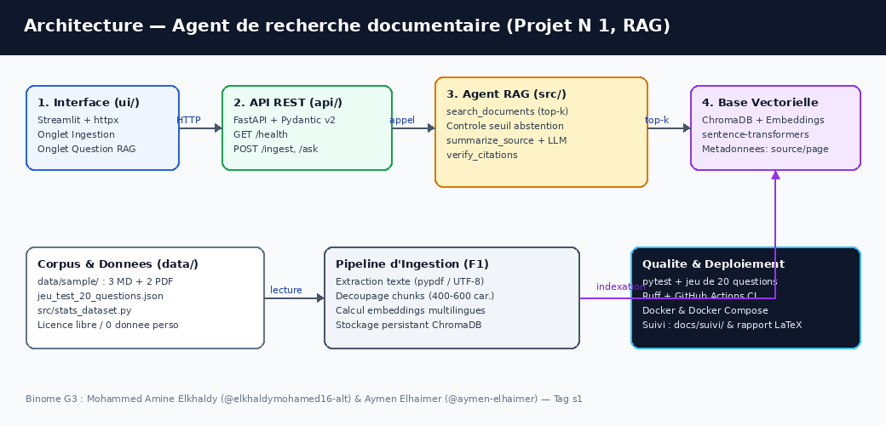
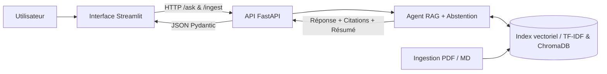

# Agent de recherche documentaire (Projet N°1 — Catalogue)

**Module :** Développement et déploiement d'applications intelligentes (EMSI Casablanca — 4IAD G3)
**Sujet du catalogue :** N°1 — Agent de recherche documentaire (Catégorie : Connaissance et RAG)
**Binôme :**
- **Mohammed Amine Elkhaldy** (`@elkhaldymohamed16-alt`) — Architecture, moteur RAG, API et intégration
- **Aymen Elhaimer** (`@aymen-elhaimer`) — Données, ingestion, évaluation, tests et conteneurisation

## Objectif

Interroger en langage naturel un corpus de documents techniques et réglementaires (PDF texte et Markdown) et obtenir en moins de 10 secondes une réponse sourcée avec citations exactes (fichier, section/page) et mécanisme d'abstention lorsque la question sort du corpus.

## Architecture globale





## Installation et démarrage rapide

```bash
git clone https://github.com/elkhaldymohamed16-alt/agent-recherche-documentaire.git
cd agent-recherche-documentaire
python3.11 -m venv .venv
source .venv/bin/activate
pip install -r requirements.txt
cp .env.example .env
```

## Exécution du squelette et des tests

```bash
python src/stats_dataset.py
python src/agent.py "Quels sont les trois artefacts à versionner dans une application IA ?"
pytest -q
```

## Structure du dépôt

- `src/` : moteur de recherche documentaire (`agent.py`) et statistiques du corpus (`stats_dataset.py`)
- `tests/` : tests automatisés (`test_smoke.py`)
- `data/sample/` : échantillon de 5 documents (3 Markdown, 2 PDF) et jeu de test de 20 questions
- `docs/` : équipe (`equipe.md`), architecture (`architecture.png`), suivi hebdomadaire (`suivi/fiche-semaine-1.md`), dossier de lancement (`semaine1/`) et modèle LaTeX (`rapport/`)
