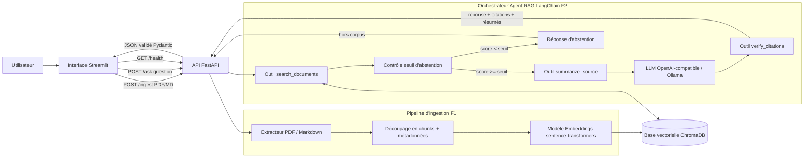
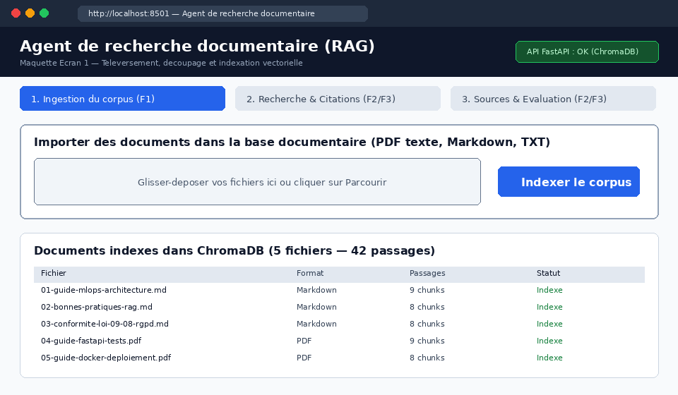
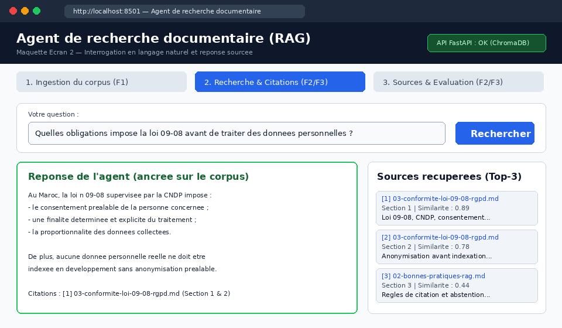
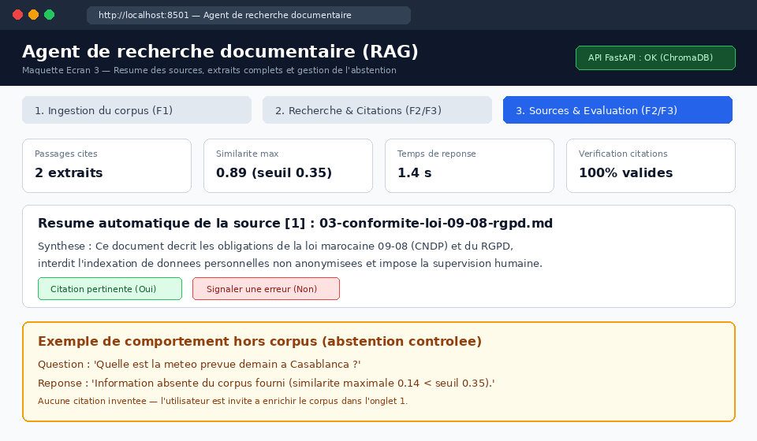

# Livrable 3 : maquette globale

**Rédacteur :** Mohammed Amine Elkhaldy (`@elkhaldymohamed16-alt`) &emsp; **Relecteur :** Aymen Elhaimer (`@aymen-elhaimer`) &emsp; **Fichiers :** `docs/semaine1/3-maquette.md` + `docs/semaine1/img/`

## 3.1 Schéma d'architecture

## 3.2 Légende du schéma

| Composant | Rôle | Fonctionnalité servie |
| --- | --- | --- |
| **Interface Streamlit** | Page web découplée à trois onglets communiquant par HTTP (`httpx`) avec l'API | F1, F2, F3 |
| **API FastAPI** | Point d'entrée unique (`/health`, `/ingest`, `/ask`) validant les contrats Pydantic v2 | F1, F2 |
| **Extracteur & Chunking** | Lit les PDF/Markdown, normalise le texte et découpe en passages avec `source`, `section`, `page` | F1 |
| **Modèle Embeddings (`sentence-transformers`)** | Convertit chaque passage et chaque question en vecteur dense multilingue | F1, F2 |
| **Base vectorielle ChromaDB** | Stocke les vecteurs et métadonnées de façon persistante et exécute la recherche cosinus top-k | F1, F2 |
| **Outil `search_documents` + Seuil d'abstention** | Récupère les meilleurs passages et déclenche une abstention si la similarité maximale est trop faible | F2 |
| **Outil `summarize_source` + LLM** | Résume chaque source retenue et génère une réponse synthétique strictement ancrée sur les extraits | F2 |
| **Outil `verify_citations`** | Contrôle que chaque référence citée dans la réponse appartient bien aux documents récupérés | F2 |
| **Docker Compose & GitHub Actions** | Conteneurise les services (`api`, `ui`, volume ChromaDB) et exécute `ruff`, `mypy`, `pytest` | Transverse (Qualité/Déploiement) |

## 3.3 Maquette des écrans

| Écran | Image (`img/...`) | Fonctionnalités affichées | Action principale de l'utilisateur |
| --- | --- | --- | --- |
| Écran 1 : Ingestion du corpus | [`img/ecran1-ingestion.png`](img/ecran1-ingestion.png) | F1 (téléversement PDF/MD, état de l'index, nombre de chunks) | Importer des documents et cliquer sur « Indexer le corpus » |
| Écran 2 : Recherche RAG & Citations | [`img/ecran2-recherche-rag.png`](img/ecran2-recherche-rag.png) | F2, F3 (champ de question, réponse ancrée, top-3 sources et scores) | Poser une question en langage naturel et cliquer sur « Rechercher » |
| Écran 3 : Inspection, Résumé & Abstention | [`img/ecran3-evaluation-sources.png`](img/ecran3-evaluation-sources.png) | F2, F3 (résumé des sources, métriques de confiance, gestion hors corpus) | Consulter le résumé d'une source, vérifier l'extrait et évaluer la pertinence |

### Aperçu des maquettes

## 3.4 Parcours utilisateur

1. **Écran 1 (Ingestion)** : l'utilisateur vérifie le bandeau `API FastAPI : OK`, dépose un nouveau document PDF ou Markdown (ou conserve les 5 documents déjà indexés) et clique sur « Indexer le corpus » ; le tableau se met à jour avec le nombre de passages créés.
2. **Écran 2 (Recherche RAG)** : l'utilisateur passe sur le deuxième onglet, saisit sa question et clique sur « Rechercher » ; l'interface affiche la réponse structurée à gauche et les 3 passages les plus pertinents (avec leur score de similarité) à droite.
3. **Écran 3 (Sources & Évaluation)** : l'utilisateur inspecte le résumé de chaque source citée, confirme ou signale la pertinence de la citation, ou constate le message d'abstention explicite lorsqu'une question sort du périmètre du corpus.

## Critères d'acceptation (vérifiés par le relecteur : Aymen Elhaimer)

- [x] Chaque composant du livrable 1 apparaît dans le schéma, et inversement.
- [x] Le parcours d'une requête se suit de bout en bout sur le schéma.
- [x] Chaque fonctionnalité du MVP (F1, F2, F3) est visible sur au moins un écran.
- [x] Le schéma Mermaid est valide et les trois images PNG sont présentes dans `docs/semaine1/img/`.
