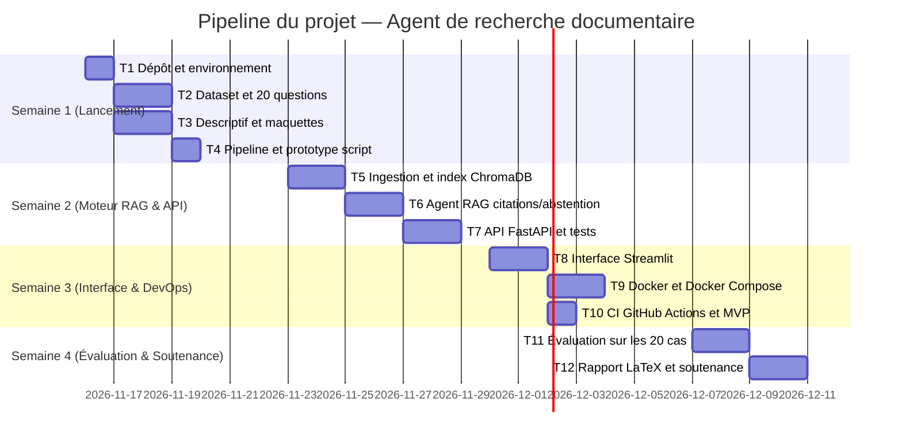

# Livrable 4 : pipeline des tâches prévues

**Consolidateur :** Aymen Elhaimer (`@aymen-elhaimer`) &emsp; **Relecteur :** Mohammed Amine Elkhaldy (`@elkhaldymohamed16-alt`) &emsp; **Fichier :** `docs/semaine1/4-pipeline.md`

## 4.1 Liste des tâches

| ID | Tâche | Fonctionnalité | Responsable | Dépend de | Semaine | Durée | Terminée quand ? (critère vérifiable) |
| --- | --- | --- | --- | --- | --- | --- | --- |
| T1 | Initialiser le dépôt GitHub, `.gitignore`, environnement Python 3.11 et structure du projet | Transverse | Amine Elkhaldy | — | 1 | 1 j | Dépôt clonable, environnement actif et modèle LaTeX présent |
| T2 | Constituer l'échantillon documentaire (`data/sample/`) et le jeu de test de 20 questions | F1, F2 | Aymen Elhaimer | T1 | 1 | 2 j | 5 fichiers PDF/MD ouvrables sans erreur et `jeu_test_20_questions.json` validé |
| T3 | Rédiger le descriptif, le schéma d'architecture et les maquettes d'écrans | F1, F2, F3 | Amine Elkhaldy | T1 | 1 | 2 j | `1-descriptif.md`, `3-maquette.md` et 3 PNG visibles sur GitHub |
| T4 | Consolider le pipeline des tâches et réaliser un prototype script d'extraction + recherche | F1 | Aymen Elhaimer | T2 | 1 | 1 j | `4-pipeline.md` fusionné et script CLI renvoyant le top-3 sur `data/sample/` |
| T5 | Implémenter le pipeline d'ingestion, chunking et indexation ChromaDB avec métadonnées | F1 | Aymen Elhaimer | T4 | 2 | 2 j | Les documents PDF/MD sont indexés avec persistance et une requête renvoie top-4 en < 2 s |
| T6 | Implémenter l'agent RAG LangChain (réponse ancrée, citations, résumé des sources et abstention) | F2 | Amine Elkhaldy | T5 | 2 | 2 j | Réponse sourcée générée sur les questions du corpus et abstention vérifiée sur la question hors corpus |
| T7 | Développer l'API FastAPI (`/health`, `/ingest`, `/ask`), schémas Pydantic et tests unitaires | F1, F2 | Aymen Elhaimer | T6 | 2 | 2 j | `pytest tests/test_api.py` 100 % vert, codes 200/422/503/500 vérifiés |
| T8 | Développer l'interface Streamlit à 3 onglets (client HTTP `httpx` découplé) et ses tests | F3 | Amine Elkhaldy | T7 | 3 | 2 j | Les 3 onglets fonctionnent avec l'API et `pytest tests/test_ui.py` passe au vert |
| T9 | Conteneuriser l'application (Dockerfiles `api`/`ui`, `docker-compose.yml` et volume ChromaDB) | Transverse | Aymen Elhaimer | T8 | 3 | 2 j | `docker compose up --build` démarre API (8000) et UI (8501) avec `/health` OK |
| T10 | Configurer la CI GitHub Actions (`ruff`, `mypy`, `pytest` avec couverture) et valider le MVP | Transverse | Amine Elkhaldy | T8 | 3 | 1 j | Pipeline CI vert sur `main` et démonstration bout-en-bout des fonctionnalités F1–F3 |
| T11 | Exécuter l'évaluation complète sur le jeu de 20 questions (`Recall@3`, fidélité des citations, latence) | F2 | Aymen Elhaimer | T10 | 4 | 2 j | Rapport chiffré généré dans `docs/evaluation.md` avec `Recall@3 >= 0,90` et 0 citation inventée |
| T12 | Rédiger le rapport LaTeX final (`docs/rapport/`), geler la version et préparer la soutenance | Transverse | Amine Elkhaldy | T11 | 4 | 2 j | PDF compilé sans erreur, tag final poussé et support de soutenance prêt |

## 4.2 Jalons hebdomadaires

| Semaine | Jalon démontrable | Tâches qui y mènent |
| --- | --- | --- |
| 1 (16–22 nov.) | Dossier de lancement fusionné (`semaine1-remis`), échantillon réel et prototype en script | T1, T2, T3, T4 |
| 2 (23–29 nov.) | Indexation ChromaDB, agent RAG avec citations exposé par FastAPI et premiers tests | T5, T6, T7 |
| 3 (30 nov.–6 déc.) | MVP complet (F1, F2, F3), interface Streamlit, Docker Compose et CI au vert | T8, T9, T10 |
| 4 (7–13 déc.) | Résultats mesurés sur les 20 questions, rapport LaTeX compilé, code gelé et soutenance | T11, T12 |

## 4.3 Vue chronologique

## 4.4 Chemin critique et charge

- **Chemin critique :** `T1 -> T2 -> T4 -> T5 -> T6 -> T7 -> T8 -> T10 -> T11 -> T12` (tout retard sur l'ingestion ChromaDB, l'agent RAG ou l'API décale l'intégration Streamlit et l'évaluation finale).
- **Charge par membre :**
  - **Mohammed Amine Elkhaldy (Membre A) :** 10 jours (T1: 1j, T3: 2j, T6: 2j, T8: 2j, T10: 1j, T12: 2j).
  - **Aymen Elhaimer (Membre B) :** 11 jours (T2: 2j, T4: 1j, T5: 2j, T7: 2j, T9: 2j, T11: 2j).
  - **Écart de charge :** 1 jour (< 2 jours requis).

## Critères d'acceptation (vérifiés par le relecteur : Mohammed Amine Elkhaldy)

- [x] Aucune tâche ne dépasse 2 jours.
- [x] Chaque fonctionnalité du MVP (F1, F2, F3) a au moins une tâche, et chaque tâche a un critère de fin vérifiable.
- [x] Le MVP est complet en fin de semaine 3 (jalon S3).
- [x] Chaque membre a ses tâches définies avec un écart de charge de 1 jour (< 2 jours).
- [x] Les tâches sont prêtes à être suivies en issues GitHub.
